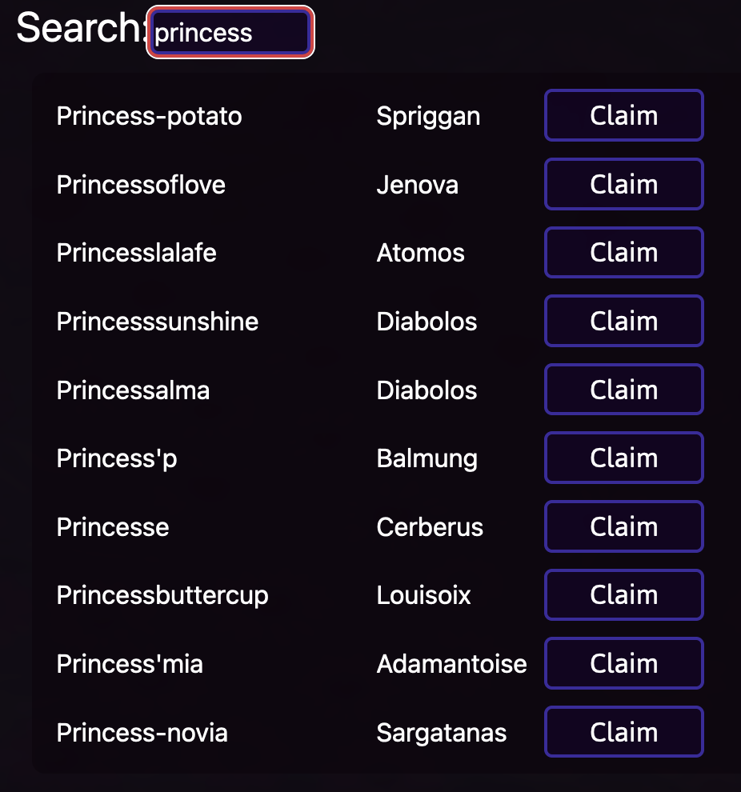
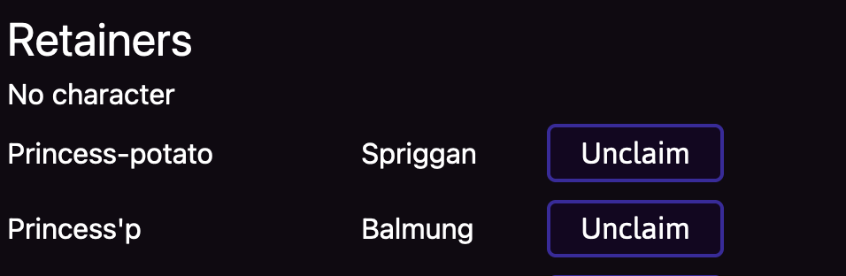
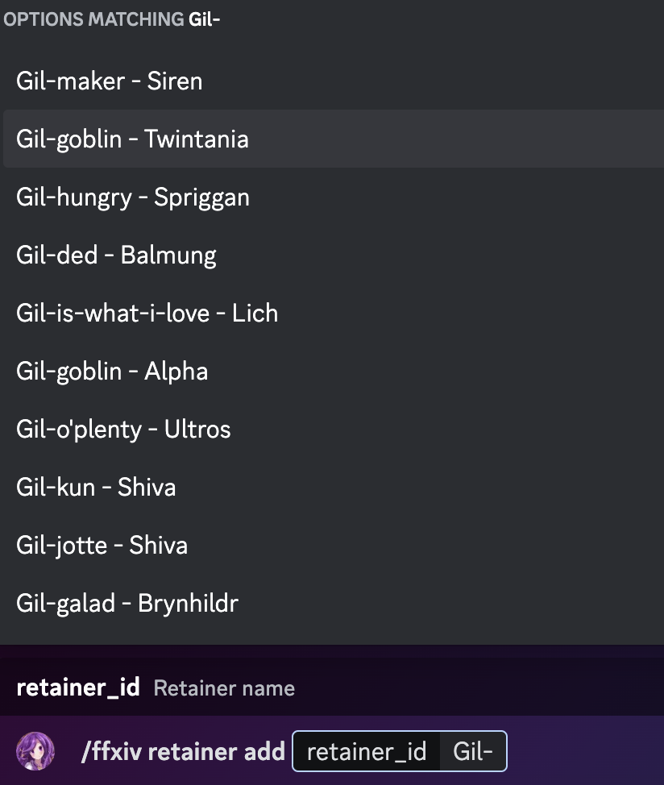

# Managing retainers

This chapter covers managing retainers via the [website](#using-website) and [discord](#using-discord).

## Using website
Once you're logged into [ultros](https://ultros.app/retainers/edit) you should be able to join the server.
https://ultros.app/retainers/edit

From there- you should be able to see all of the retainers that you have added to your account. in a table and a search bar.

### Adding a retainer

Type the name of your retainer into the search box and then click the claim button when the retainer shows up.

### Updating retainers
Once you have retainers added, you should see them listed here:

It is possible to associate a retainer to a specific character, which is why we see "No character" above. Character management is covered [here](../characters/character.md)

To reorder the retainers (I highly suggest you match the order of your retainers in game), you may simply drag and drop them.

To remove them, you just need to click unclaim!

## Using Discord

### Adding a retainer on Discord

Use `/ffxiv retainer add` to open setup, or provide a name directly:
`/ffxiv retainer add retainer:Moonkeeper world:Gilgamesh`.
The world is optional: leaving it blank searches all worlds, even if you have
not added any characters. As you type the retainer name, autocomplete shows
the name and world of matching retainers.

Choose the retainer and world that match yours. You can also type a complete
name: if it matches retainers on several worlds, the bot asks you to choose.
If nothing matches, edit the search or search all worlds. A retainer must have
appeared in Ultros's market data before it can be found.

The retainer is saved immediately. **Assign / change character** lets you
choose one of your characters, add another character by searching the
Lodestone, or leave the retainer unassigned. There is no verification
challenge and no need to leave Discord. If a character lookup fails, the
retainer stays tracked.

**Add another** keeps the selected character visible during this setup
session. You can change the world or switch characters before continuing,
including when your alts share a world. A fresh add command starts without
a character unless you provide the optional `character` parameter.

Adding the same retainer again opens its existing record and preserves its
character assignment. Setup replies to slash commands are private. When a
menu expires, use `/ffxiv retainer list` to continue; saved retainers remain.

### Remove

`/ffxiv retainer remove`

### List

You can check the list of all of your retainers with
`/ffxiv retainer list`

The menu groups retainers by character, including an Unassigned group, and
shows each retainer's world. Choose a retainer to change its character or
remove it from your account.

**Set up alerts** explains the commands to run in your chosen channel or a
DM with the bot. Alerts cover all your tracked retainers across characters
and worlds. Adding a retainer does not enable alerts automatically.
